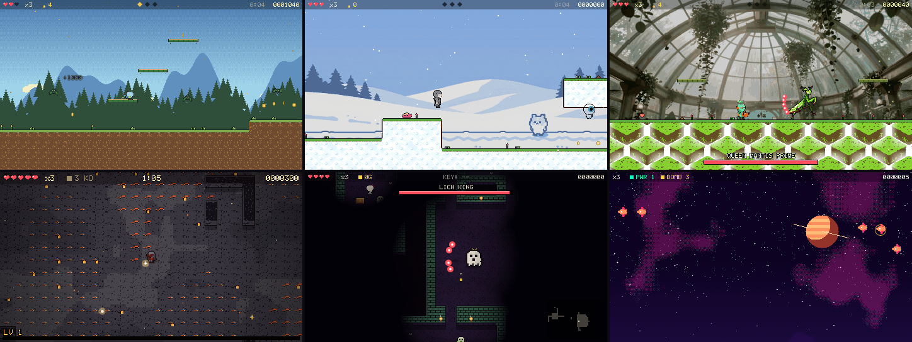
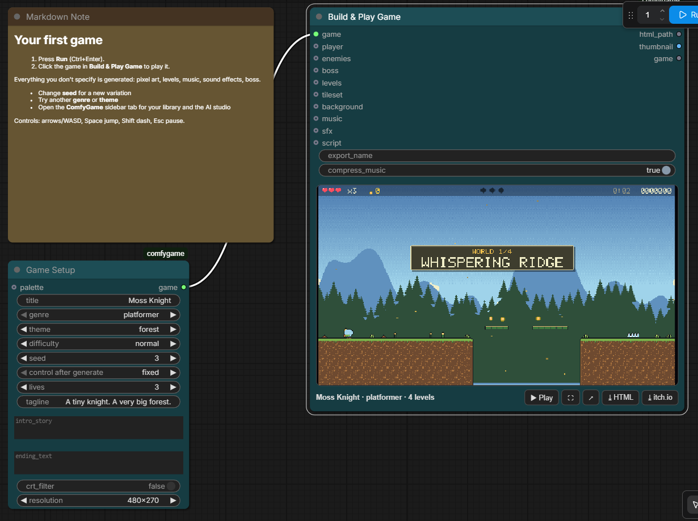
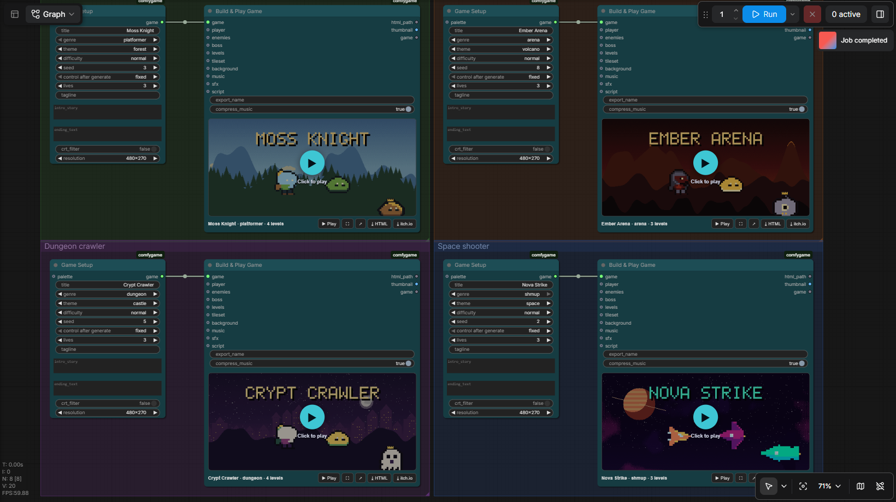
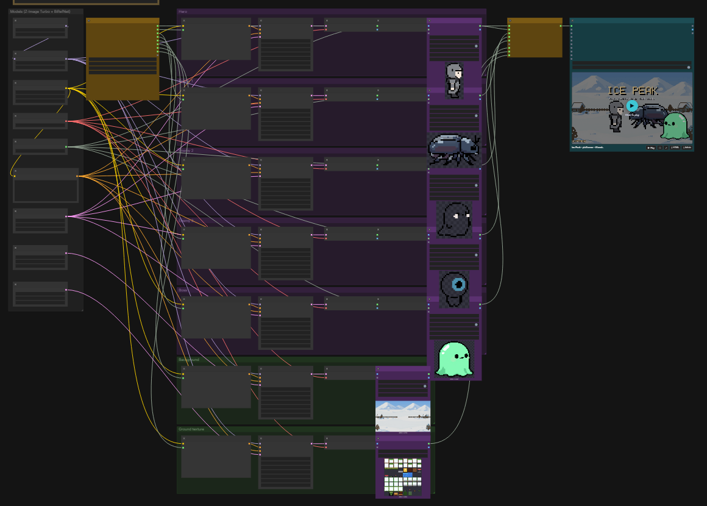
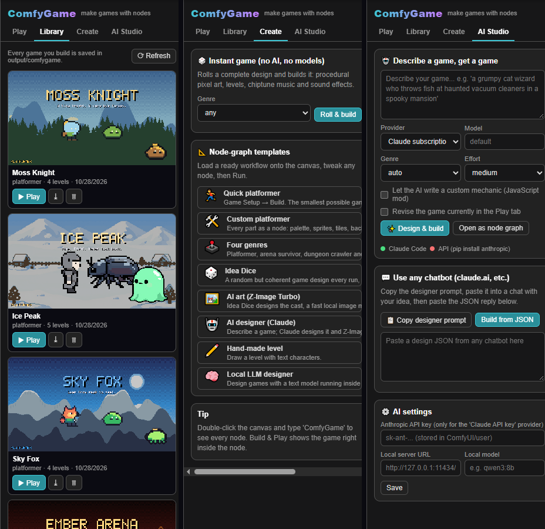

# ComfyGame

**Turn ComfyUI into a game engine.** Wire a few nodes, press Run, and play a complete, polished game right inside the node: pixel art, levels, music, sound effects, menus, a boss fight and a victory screen. Export it as one HTML file that runs anywhere.



ComfyGame works **fully offline with no models at all**: every asset can be generated procedurally. When you want more, it plugs into what ComfyUI is great at: **local image models** draw your cast and backgrounds, and **LLMs** (Claude through your subscription or an API key, Ollama / LM Studio, or a text model running inside ComfyUI) design whole games from one sentence.



## Highlights

- **Four genres, each with real depth**
  - **Platformer**: coyote time, jump buffering, variable jump height, double jump, wall jump, dash, stomps, moving and crumbling platforms, springs, ?-blocks, spikes, lava, checkpoints, 3 secret gems per level, boss arenas.
  - **Arena survivor**: escalating wave timelines, auto-aim or mouse/stick aim, dodge roll, XP gems and 11 level-up upgrades (multishot, piercing, orbit blades, shock nova...), boss with spiral / burst / charge / summon patterns.
  - **Dungeon crawler**: room-and-corridor floors, torch lighting and darkness, sword or magic, key chests and locked stairs, loot, traps, minimap, a boss floor.
  - **Space shooter**: formations (lines, sine weavers, V, divers, turrets, swarms), 4 weapon power levels with homing missiles, bombs, shields, chain scoring, multi-phase bullet-pattern bosses.
- **Polish everywhere**: title screen with a live demo, story intro, level banners, pause menu, level-clear tally, game over, victory credits, high scores, screen shake, hit-stop, particles, squash and stretch, ambient weather, parallax, seamless chiptune loops, gamepad and touch controls.
- **Everything is a node**: palettes, procedural sprites (heroes, creatures, ships, bosses, items), tilesets, parallax backgrounds, levels (generated or drawn as ASCII), enemies and their behaviours, music, sound effects, gameplay scripts. Swap any part for your own.
- **AI art the ComfyUI way**: any image becomes a game asset. *Sprite From Image* cuts out, pixelates (palette-aware, keeps outlines) and animates it; *Background From Image* and *Tileset From Texture* turn renders into scenery and ground materials. A ready template uses **Z-Image Turbo** (~2 s per asset on a 16 GB GPU).
- **AI designer**: describe a game, get a game. The LLM writes the design (title, story, cast, behaviours, levels, music, image prompts) and, if you like, a JavaScript mod with a signature mechanic.
- **Guaranteed playable**: generated platformer levels are checked against the engine's jump physics (tests cover 480 levels), dungeon keys and stairs are always reachable.
- **Share anywhere**: one self-contained HTML file per game (~1.7 MB, no server, no internet), plus a one-click zip for itch.io.

## Install

ComfyGame needs no extra Python packages.

```bash
cd ComfyUI/custom_nodes
git clone <this-repository-url> comfygame
```

Restart ComfyUI. With **ComfyUI-Manager** you can use *Install via Git URL* instead. ComfyUI **Desktop** users: the `custom_nodes` folder is inside your install folder (e.g. `ComfyUI-Installs/<name>/ComfyUI/custom_nodes`).

Requirements: a recent ComfyUI with the V3 node API and the new frontend (tested on ComfyUI 0.37.2, frontend 1.52.7). No GPU is needed for procedural games.

## Your first game in a minute

1. Open the **ComfyGame** tab in the left sidebar (gamepad icon) → **Create** → **Quick platformer**. Or use *Roll & build* for an instant random game.
2. Press **Run**.
3. Click the game inside **Build & Play Game**. Arrows/WASD to move, Space to jump, Esc to pause.

Change the **seed** for a new variation, switch the **genre** or **theme**, and run again. Builds take about 3 seconds.

## The node graph



| Category | Nodes |
|---|---|
| Core | **Game Setup** (title, genre, theme, difficulty, seed, story), **Build & Play Game** (assembles, fills in anything missing, exports, plays), **Game Info** |
| Art | **Palette**, **Palette From Image**, **Pixel Sprite** (procedural heroes, creatures, ships, items), **Pixel Boss**, **Sprite From Image**, **Tileset**, **Tileset From Texture**, **Parallax Background**, **Background From Image** |
| World | **Platformer Levels**, **Dungeon Floors**, **Arena Stages**, **Shmup Stages**, **Level From Text (ASCII)** |
| Actors | **Player** (stats, abilities, weapon), **Enemy** (chain as many as you like; 14 behaviours), **Boss** |
| Audio | **Chiptune Music** (10 moods, 4 instrument sets, seamless loops), **Music From Audio** (any ComfyUI audio), **Sound Effects**, **Sound From Audio** |
| Design / AI | **Game Idea Dice** (no AI), **AI Game Designer (LLM)**, **Game From Design JSON**, **Game Art Prompt**, **Apply Art To Game**, **Game Script (JavaScript mod)**, **AI Script** |

Every part is optional. Unconnected procedural art is recoloured to the game's palette automatically so everything matches.

Templates (also in ComfyUI's template browser under *comfygame*): `01_quick_platformer`, `02_custom_platformer`, `03_all_genres`, `04_idea_dice`, `05_ai_art_zimage`, `06_ai_designer_claude`, `07_ascii_level`, `08_local_llm`.

## AI mode

### Draw the cast with a local image model



Template **05_ai_art_zimage**: *Game Idea Dice* writes one prompt per asset, **Z-Image Turbo** draws player, three enemies, boss, background and ground texture, **Remove Background** (BiRefNet) cuts the characters out, and the ComfyGame nodes turn them into sprites, scenery and a ground material. About 40 seconds on an RTX 4070 Ti SUPER. If a model is missing, ComfyUI offers to download it when the workflow opens. Any image model works; swap the sampler chain for SDXL, Flux or your favourite.

### Design with an LLM

The **AI Game Designer** node, and the **AI Studio** tab in the panel, support:

| Provider | What you need |
|---|---|
| `claude_code` (Claude subscription) | [Claude Code](https://claude.com/claude-code) installed and logged in once (`claude`). No API key. |
| `anthropic_api` (Claude API key) | `pip install anthropic` into ComfyUI's Python and a key (panel → AI settings, or `ANTHROPIC_API_KEY`). |
| `openai_compat` (local server) | Ollama, LM Studio, llama.cpp or vLLM running; set URL and model in AI settings. |
| `comfy_local` (inside ComfyUI) | A text-generation model in **Load CLIP**, e.g. `qwen_3_4b.safetensors` that ships with Z-Image Turbo (template `08_local_llm`, ~80 s, no internet). |
| Any chatbot | Panel → AI Studio → *Copy designer prompt*, paste into any chat, paste the JSON back. |

Tick **custom_mechanic_code** to let the model add a gameplay mod (for example a noise meter that triggers a shush shockwave in a library-ghost survivor game). ComfyGame only contacts a provider when you run an AI node or press a button in the AI Studio; everything else stays on your machine.



## Making it yours

- **Draw levels as text** with *Level From Text*: `#` ground, `=` platform, `^` spikes, `o` coin, `*` gem, `?` bonus block, `S` spring, `M`/`V` moving platform, `X` crumbling block, `L` lava, `a`-`h` enemies, `B` boss, `P` start, `G` goal, `C` checkpoint. Dungeons: `#` wall, `.` floor, `<` start, `>` stairs, `k` key chest, `c` chest, `t` torch, `^` trap.
- **Script new mechanics** in JavaScript with the *Game Script* node: hooks like `onUpdate`, `draw`, `onEnemyKilled`, `onPlayerHit`. See [docs/SCRIPTING.md](docs/SCRIPTING.md).
- **Write designs by hand** (or with any AI) in the design JSON format: [docs/DESIGN_JSON.md](docs/DESIGN_JSON.md).
- **Creative recipes** and a tour of everything: [docs/GUIDE.md](docs/GUIDE.md).

## Playing and sharing

Controls: arrows/WASD move, Space/Z jump or dodge, X/J attack or bomb, Shift/C dash or focus, Esc pause, M mute, F fullscreen. Gamepads and touch screens work.

Games live in `ComfyUI/output/comfygame/<name>/index.html`. Use the node's buttons (or the Library tab) to open a game in a browser tab, download the single HTML file, or download an itch.io-ready zip (upload as an HTML5 game). Exported games make no network requests.

## Automation

Everything runs through ComfyUI's normal queue, so `/prompt` with any ComfyGame graph works. ComfyGame also adds:

| Route | Does |
|---|---|
| `GET /api/comfygame/games` | list built games |
| `GET /api/comfygame/play/{id}` | play a game |
| `GET /api/comfygame/download/{id}` (`?zip=1`) | single HTML file or itch.io zip |
| `POST /api/comfygame/build` `{"design": {...}}` | build straight from a design JSON |
| `POST /api/comfygame/design` `{"idea": "...", "provider": "claude_code"}` | ask an LLM for a design |
| `GET /api/comfygame/dice?seed=7&genre=arena` | roll a random design |
| `GET /api/comfygame/system_prompt` | the designer prompt for any chatbot |

```bash
# roll a random design, then build it
curl -s "http://127.0.0.1:8188/api/comfygame/dice?seed=7" -o design.json
curl -s -X POST http://127.0.0.1:8188/api/comfygame/build -H "Content-Type: application/json" \
     -d "{\"design\": $(cat design.json)}"
```

Without ComfyUI: `python tools/build_game.py --genre dungeon --seed 4 --out games` (needs numpy and Pillow).

## Development

```
comfygame/        Python: nodes, routes, generators (sprites, tiles, backgrounds, levels, audio), LLM providers
runtime/          JavaScript engine embedded in every game (core + one file per genre)
web/              ComfyUI frontend extension (in-node player, sidebar panel)
example_workflows/  templates (generated by tools/make_workflows.mjs inside the real frontend)
tests/            pytest: level reachability, builds, design parsing
tools/            CLI builder, headless-Chrome playtest / smoke / UI end-to-end harnesses
```

- `python -m pytest tests` runs without ComfyUI.
- `node tools/smoke.mjs <base-url> <game-id>...` plays built games with a bot in headless Chrome and walks every level to the victory screen.
- `node tools/ui_e2e.mjs` loads each template in the real ComfyUI frontend, queues it and checks the in-node player.

## License

MIT. Games you make are yours.
